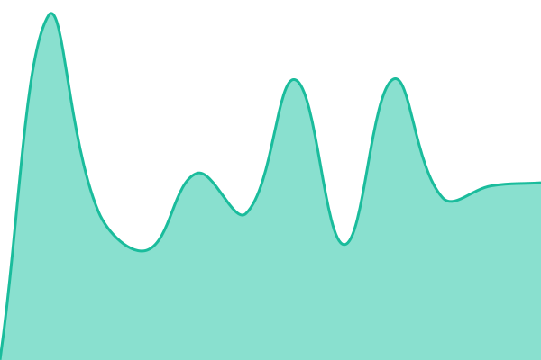

# [📈 Live Status](https://status.highwayradio.f5.si): <!--live status--> **🟧 Partial outage**

This repository contains the open-source uptime monitor and status page for [𛃤ー / yu-](https://highwayradio.cloudfree.jp/), powered by [Upptime](https://github.com/upptime/upptime).

With [Upptime](https://upptime.js.org), you can get your own unlimited and free uptime monitor and status page, powered entirely by a GitHub repository. We use [Issues](https://github.com/sagashi0120/highwayradio-uptime/issues) as incident reports, [Actions](https://github.com/sagashi0120/highwayradio-uptime/actions) as uptime monitors, and [Pages](https://status.highwayradio.f5.si) for the status page.

<!--start: status pages-->
<!-- This summary is generated by Upptime (https://github.com/upptime/upptime) -->
<!-- Do not edit this manually, your changes will be overwritten -->
<!-- prettier-ignore -->
| URL | Status | History | Response Time | Uptime |
| --- | ------ | ------- | ------------- | ------ |
|  [Web](https://highwayradio.cloudfree.jp/) | 🟩 Up | [web.yml](https://github.com/sagashi0120/highwayradio-upptime/commits/HEAD/history/web.yml) | 

 1728ms
     
 | 

<a href="https://status.highwayradio.f5.si/history/web">100.00%</a>
    

|  [Image](https://img.highwayradio.f5.si/) | 🟥 Down | [image.yml](https://github.com/sagashi0120/highwayradio-upptime/commits/HEAD/history/image.yml) | 

 207ms
     
 | 

<a href="https://status.highwayradio.f5.si/history/image">56.69%</a>
    

|  [Blog](https://blog.highwayradio.f5.si/) | 🟩 Up | [blog.yml](https://github.com/sagashi0120/highwayradio-upptime/commits/HEAD/history/blog.yml) | 

 1134ms
     
 | 

<a href="https://status.highwayradio.f5.si/history/blog">100.00%</a>
    

<!--end: status pages-->

[**Visit our status website →**](https://status.highwayradio.f5.si)

## 📄 License

- Powered by: [Upptime](https://github.com/upptime/upptime)
- Code: [MIT](./LICENSE) © [Anand Chowdhary](https://anandchowdhary.com)
- Data in the `./history` directory: [Open Database License](https://opendatacommons.org/licenses/odbl/1-0/)
